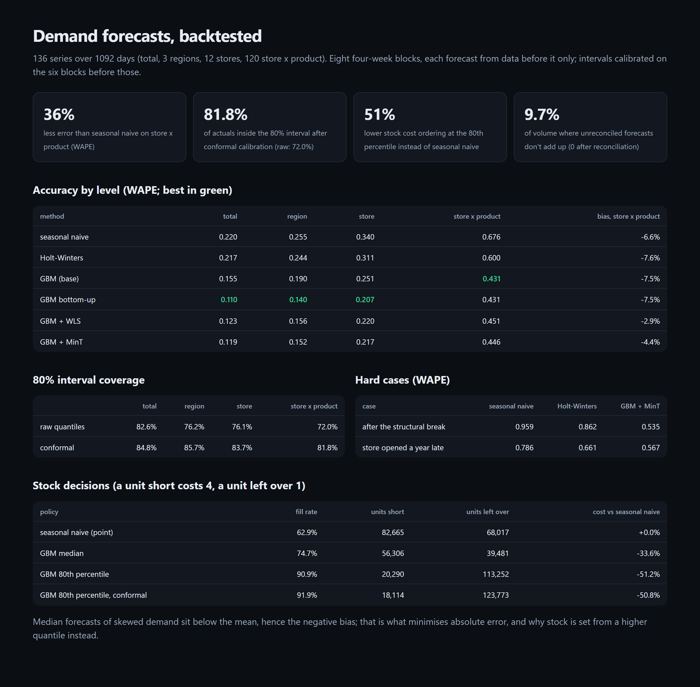

# Demand Forecasting

Hierarchical, probabilistic demand forecasting for a retail chain. One global gradient-boosted
model, with quantile loss, covers every store, product and level. Its intervals are calibrated with
conformal prediction, and its forecasts are reconciled so stores add up to regions and regions to
the total. It is backtested on rolling four-week blocks against seasonal-naive and Holt-Winters, then
turned into stock decisions and costed.

[](https://github.com/codeROCK-IZZY/demand-forecasting/actions/workflows/ci.yml)



## Results

From `forecast evaluate` (136 series, 3 years daily, 8 four-week backtest blocks, each forecast only
from data before it; [full report](eval/reports/evaluation.md)):

| WAPE | total | region | store | store x product |
|---|---:|---:|---:|---:|
| seasonal naive | 0.220 | 0.255 | 0.340 | 0.676 |
| Holt-Winters (per series) | 0.217 | 0.244 | 0.311 | 0.600 |
| global GBM, unreconciled | 0.155 | 0.190 | 0.251 | 0.431 |
| **global GBM, bottom-up** | **0.110** | **0.140** | **0.207** | **0.431** |
| global GBM + MinT | 0.119 | 0.152 | 0.217 | 0.446 |

- **36% less error** than seasonal naive at store x product level, and 28% less than Holt-Winters.
- **Reconciliation:** unreconciled forecasts disagree by 9.7% of volume. Bottom-up makes them add
  up and is the most accurate at every level here, ahead of MinT and WLS. The report shows all three
  rather than assuming the textbook winner.
- **Calibrated intervals:** the raw quantile model's 80% intervals cover only 72.0% of store x
  product outcomes. Conformal calibration on six earlier blocks brings that to **81.8%**.
- **Hard cases:** after a competitor takes 40% of one product's demand in one region, WAPE is
  0.535 against 0.959 for seasonal naive. A store that opened a year late is forecast at 0.567
  against 0.786.

**Stock decisions** (a unit short costs 4 in lost margin, a unit left over costs 1 in waste, so the
cost-minimising order is the 80th percentile):

| ordering policy | fill rate | cost vs seasonal naive |
|---|---:|---:|
| seasonal naive point forecast | 62.9% | baseline |
| GBM median | 74.7% | −33.6% |
| **GBM 80th percentile** | **90.9%** | **−51.2%** |
| GBM 80th percentile, conformal | 91.9% | −50.8% |

Ordering at the right quantile matters more than a better point forecast. Calibrating the 80th
percentile improves coverage but barely changes cost.

## How it works

- `data.py`: a 12-store chain in 3 regions selling 10 products. It has category-specific yearly
  seasons, a weekly pattern, promotions planned in advance, holidays, price elasticity, slow movers
  (10% of days sell nothing), a late-opening store, a structural break and negative binomial noise.
- `models.py`: seasonal naive, Holt-Winters (vectorised, smoothing chosen per series), and the global
  GBM: scaled targets, features known at the origin only, direct multi-horizon rows, 10/50/80/90th
  percentile models ([ADR 1](docs/adr/0001-one-global-model.md)).
- `reconcile.py`: bottom-up, WLS and MinT with a Schäfer-Strimmer shrunk covariance; negative
  forecasts are clipped at the bottom and re-aggregated so results stay coherent.
- `evaluate.py`: calibration blocks, conformalized quantile regression per level, the rolling
  backtest, MASE/WAPE/bias by level, and the stock simulation
  ([ADR 2](docs/adr/0002-calibrate-then-decide.md)).

## Run it

```bash
python -m venv .venv && . .venv/bin/activate
pip install -e ".[dev]"
pytest
forecast evaluate --gate        # ~5 min; writes eval/reports/{evaluation.md,evaluation.json,report.html}
forecast store 3                # the next four weeks for store 3, with actuals alongside
```

| check | where |
|---|---|
| 9 tests (including one that changes the future and checks no feature moves), strict mypy, ruff | `tests/`, `src/` |
| the backtest as a CI gate (beats both baselines at every level, coherent, coverage within 3 points, costs in order) | `.github/workflows/ci.yml` |

See [known limitations](docs/known-limitations.md).

## License

MIT
